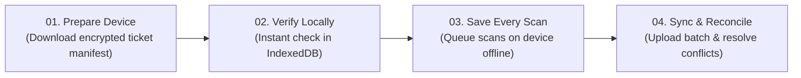
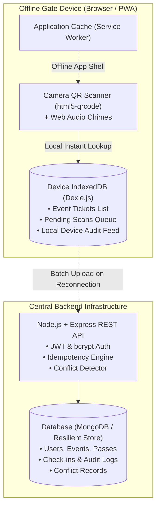
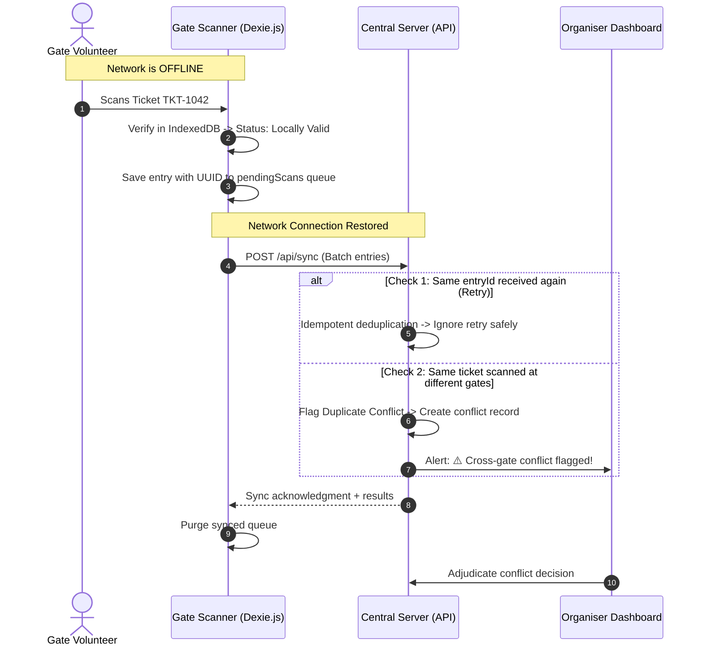

# ⚡ BLACKOUT: Offline-First Event Entry System

> **"Event entry that keeps working when the internet stops."**  
> **Presenter:** Gulshan Kumar  
> **Hackathon:** Full Stack Development Hackathon  

---

## 🎪 The Problem at the Gate (Slide 02)

At crowded music festivals, sporting arenas, and conferences, cell towers easily overload, Wi-Fi networks crash, and power cuts occur. Traditional online-only ticketing systems (e.g. Eventbrite, BookMyShow) fail at the gate when connectivity drops:
- Scanners stop validating tickets, forming bottlenecks and long queues.
- Security and volunteers are forced to rely on paper lists or unverified manual checks.
- Attendees face frustrating delays, while fraudulent duplicate passes go unnoticed.

**The Design Challenge:**  
Keep scanning and verifying tickets locally at high speed (&lt;10ms), store every scan safely on isolated devices, and reconcile every entry and duplicate conflict when connectivity returns.

---

## 💡 The BLACKOUT Solution (Slide 03)



1. **Prepare the Device:** Gate volunteers download the event ticket list into the device's local database before opening the gates.
2. **Verify Locally:** Scanners check QR codes directly against the downloaded local cache without any server roundtrip.
3. **Save Every Entry:** Scans are queued in browser `IndexedDB` with gate ID, device ID, volunteer name, and timestamp.
4. **Sync & Review:** Once network returns, pending entries are batch-synced to the central server. The server accepts unique entries and flags cross-gate duplicate conflicts for organiser review.

---

## 🏛️ System Architecture & Where Data Lives (Slide 09 & 10)



### Technology Stack
- **Frontend:** React 18, Vite, Tailwind CSS, Lucide Icons, Canvas Confetti
- **Offline Storage:** IndexedDB powered by **Dexie.js**
- **Offline PWA:** Progressive Web App with Service Worker asset caching
- **QR Engine:** `html5-qrcode` (webcam & camera scanner) + `qrcode` (pass generation)
- **Backend:** Node.js, Express, JWT, bcryptjs, UUID
- **Database:** MongoDB / Mongoose with built-in zero-config local document store fallback

---

## ⚡ Sync Without Losing Track & Two Different Checks (Slide 07)



---

## ⚔️ One Ticket, Two Offline Gates (Slide 08)

Isolated offline devices cannot block each other in real-time. When a fraudulent attendee shares a screenshot of `TKT-1042` with a friend entering Gate B while they enter Gate A:

| Field | Entry from Gate A | Entry from Gate B |
| :--- | :--- | :--- |
| **Ticket** | `TKT-1042` | `TKT-1042` |
| **Device** | `DEV-GATE-A` | `DEV-GATE-B` |
| **Scan Time** | 20:01:14 | 20:03:45 |
| **Offline Result** | **Locally Valid** | **Locally Valid** |
| **After Sync** | **First Recorded Entry** | **Duplicate Conflict Flagged** |

**Post-Sync Adjudication:**  
The Organiser accesses the Conflict Center, reviews both records side-by-side (timestamps, volunteers, gate IDs), and selects an official resolution:
1. **Accept First Only:** Approves Gate A, revokes Gate B.
2. **Accept Both:** Validates multi-entry or authorized VIP re-entry.
3. **Revoke & Blacklist:** Cancels the pass entirely for fraudulent distribution.

---

## 🚀 Quick Start Guide

### 1. Installation
Clone or navigate to the repository root:
```bash
cd d:\Blackout_Hackathon
npm run dev
```
*(This starts both the backend API on port 5000 and the Vite frontend on port 5173).*

### 2. Default Demo Credentials
The backend automatically creates test accounts on first run:
- **Lead Organiser:** `organizer@blackout.io` / `password123`
- **Gate Volunteer:** `volunteer@blackout.io` / `password123`
- *(Or click the 1-Click Demo Login buttons on the login screen).*

---

## 🎬 Live Hackathon Demo Walkthrough (Slide 12)

You can run the full 6-step presentation demo directly from the **"Live Demo Script"** tab:

1. **Step 01 - Create Demo Event:** Click "Execute Step 1" to generate *Electric Horizon Festival* with 5 sample passes (`TKT-1042` through `TKT-1046`).
2. **Step 02 - Prepare Gate Device:** Click "Execute Step 2" to download tickets into device IndexedDB.
3. **Step 03 - Cut Internet:** Click "Simulate Blackout" (or toggle the network pill in the navbar).
4. **Step 04 - Scan at Two Offline Gates:** 
   - Click "4A. Scan at Gate A (Offline)" &rarr; Shows green `LOCALLY VALID`.
   - Click "4B. Scan at Gate B (Offline)" &rarr; Shows green `LOCALLY VALID`.
5. **Step 05 - Restore & Sync:** Click "Restore & Sync" &rarr; Re-enables connection and uploads pending scan queue.
6. **Step 06 - Review Conflict:** Click "Open Conflict Center" &rarr; View side-by-side audit trail and submit the organiser adjudication decision!

---

## 📄 License & Credits
Developed by **Gulshan Kumar** for the Full Stack Development Hackathon.  
Built with pride using React, Vite, Tailwind CSS, IndexedDB (Dexie.js), Node.js, Express, and MongoDB.
